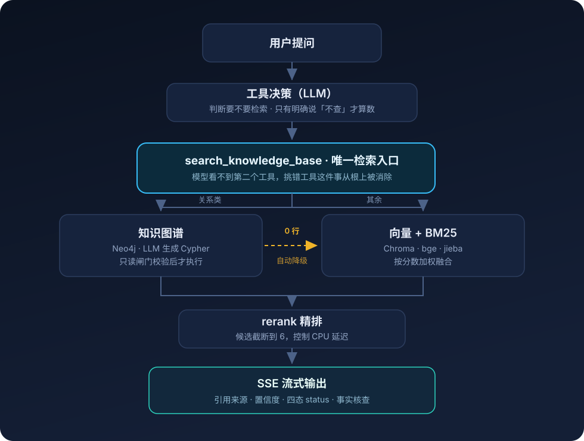

<p align="center">
  
</p>

<h1 align="center">RAG 知识库问答系统</h1>

<p align="center">
  <b>库里有什么就答什么，没有就说没有，每句话都能指回出处。</b><br>
  三路混合检索（Chroma 向量 / BM25 / Neo4j 图谱）· CPU 重排 · SSE 真流式 · 多层护栏<br>
  单机 2 vCPU / 3.5 GiB · 5 个容器 · Python 约 9000 行
</p>

<p align="center">
  <a href="https://github.com/zhtsy/rag-agent/actions/workflows/ci.yml"></a>
  <a href="https://m8ven.ai/mcp/zhtsy-rag-agent-mbudvh?s=readme"></a>
  
  
</p>

---

## 它是干什么的

往一堆自己的文档里提问，它答得出、答得对，而且每句话后面都能点回原文；库里没有的，它就说没有。

这个项目是从一句很具体的抱怨开始的：**为什么问它文档里的东西它答不上来，却敢一本正经地编？**
后来越做越发现，难的不是让它答得出，是让它在该闭嘴的时候闭嘴。所以一半以上的时间
其实花在评测和排查上——`CASE_STUDY.md` 记的就是几次被自己的数据打脸的经过。

## 结论

| 看什么 | 结论 |
|---|---|
| 38 题主评测集 | **1.0000**（38/38）。补数据前 0.9474 —— 提分来自补 18 条图边，**提示词一个字没改** |
| 10 题对抗集 | **1.0000**（10/10），含 4 道「库里没有」的拒答题全对 |
| 自动化测试 | 本地 **341 passed / 1 skipped**（6 秒）；云端容器内 **332 passed**；CI 只装 pytest，约 2 秒 |
| 性能（单机 2 vCPU） | 有实体过滤 3.68 s；同问缓存命中 0.86 s（4.3×）；并发饱和点 4 |
| 数据规模 | 145 个向量块 / 741 实体 / 882 条关系（本地复刻环境） |

## 它不擅长什么（先说清楚，省得你试完再失望）

- **域外问题它可能还是会答。** 检索层能正确判空、把 `sources` 置空，但模型有时仍会用
  自己的常识答一段，`status` 会标成 `ungrounded`——**标得出来，但没拦住**。
  硬拒答会把「资料没写但能推理」的题一起打死，我选了留这个洞并写在明处。
- **只为私有小语料设计。** 现在的分块、图谱抽取、重排都是按几百张文本卡片调的，
  换成十万级文档要改架构，不是调参能解决。
- **单机吞吐就 0.8 req/s 左右。** 并发 4 是实测饱和点，超了只是排队更久。

## 三十秒跑起来

```bash
cp .env.example .env      # 填 Neo4j / MySQL 口令与 DeepSeek key
docker compose up -d
curl -s localhost:8000/health
```

## 几个绕不开的取舍

这五条是整套设计里真正被数据逼出来的决定，其它都能改，这几条改不动。

1. **检索入口只有一个。** 图谱查不出东西就自动降级到向量 + BM25，不让模型自己挑工具——
   它挑错的时候，你在日志里看不见。
2. **没有证据就不答。** rerank 原始 top1 低于 0.15 直接返回「未在知识库中找到相关信息」，
   并把 `sources` 置空。实测 OOD 问题 ≤0.05、正常题 ≥0.6，中间没有重叠带。
3. **置信度不是「答对的概率」。** 它只是 rerank 分数，用来判「检索有没有落空」；
   拿它当业务阈值一定会出事。
4. **拒答和答对同等重要。** 补数据把准确率从 0.9474 拉到 1.0000 时，4 道拒答题
   没有一道退化成乱猜——这条对照比 1.0000 本身更有说服力。
5. **图谱的坑通常在数据，不在查询。** 有 2 道题长期答不出，不是提示词写错了，
   而是 `(城市)-[:属于]->(省)` 这条边从来没建过。完整闭环见 `CASE_STUDY.md`。

> 指标口径与采集时间见 `RESULTS.md`；三 seed 波动见 `VARIANCE.md`；
> 本地复刻云端的完整流程见 `MIGRATION.md`。

<details>
<summary><b>一次真实请求与响应（点击展开，2026-11-08 本地实测）</b></summary>

```bash
curl -N -X POST http://127.0.0.1:8000/chat/stream \
  -H 'Content-Type: application/json' \
  -H "X-API-Key: $(cat .rag_api_key)" \
  -d '{"message":"根据知识库，小赵为什么喜欢喝咖啡？","session_id":"demo"}'
```

```text
data: {"sources": ["test3.txt", "test4.txt"], "confidence": 0.9963, "status": "answered", ...}
data: [DONE]
```

> 小赵喜欢喝咖啡是因为咖啡能提神醒脑，这有助于他更好地玩英雄联盟。

这句话横跨两份文档：`test3.txt` 只说了咖啡提神，`test4.txt` 只说了小赵玩英雄联盟。
检索侧要把两块同时捞上来，生成侧要把它们拼成一句因果——这就是这里说的「多跳」。

</details>

---

## 1. 架构

| 服务 | 容器 | 端口 | 说明 |
|---|---|---|---|
| frontend | `rag_frontend` | 8501 | Streamlit 聊天界面，含 👍/👎 反馈按钮 |
| backend | `rag_backend` | 8000 | FastAPI + LangGraph 主服务 |
| neo4j | `rag_neo4j` | 7474 / 7687 | 知识图谱（含 APOC） |
| mysql | `rag_mysql` | 3306 | 问答日志 `qa_records` |
| admin | `rag_admin` | 127.0.0.1:5001 | Flask 后台（需 `X-API-Key`；只绑本机，远程访问走 SSH 隧道） |

数据流：

<p align="center">
  
</p>

<details>
<summary>同一张图的纯文本版（方便复制、也方便 grep）</summary>

```
用户提问
  └─ 工具决策（LLM 判断要不要检索）
       └─ search_knowledge_base  ← 唯一检索入口
            ├─ 意图判断：关系类问题 → 知识图谱（Cypher）
            │                    └─ 图谱 0 行 → 自动降级到向量+BM25
            └─ 向量（bge-base-zh-v1.5）+ BM25（jieba）→ RRF 融合
                 └─ reranker 精排（候选截断到 6 个，控制 CPU 延迟）
                      └─ 流式生成 → 引用来源 / 置信度 / 事实核查
```

</details>

---

## 2. 关键文件

**核心链路**

| 文件 | 作用 |
|---|---|
| `main1.py` | FastAPI 入口、SSE 流式接口、`/feedback` 落盘 |
| `rag_agent.py` | LangGraph 图、工具决策、检索选块（rerank 窗口 + 关键词加成）、流式清洗、护栏、事实核查 |
| `graph_retriever.py` | 图谱检索（自然语言问句 → Cypher → 自然句）；`entity_facts()` 给因果类问题补固有属性 |
| `bm25_retriever.py` | BM25 检索器 |
| `embeddings_shared.py` | **统一嵌入模型单例**（全项目只加载一次 bge） |
| `qa_logger.py` | 问答日志落 MySQL（参数化 SQL） |
| `memory_store.py` | **记忆持久化层**：会话轮次 / 会话实体 / 用户长期事实（MySQL；连不上自动降级） |
| `memory_context.py` | 记忆的纯函数：按句截断、长期记忆渲染、抽取提示词、抽取结果解析（零依赖，可单测） |
| `admin_app.py` | 后台：查看/删除/导出问答记录 |

**数据构建**

| 文件 | 作用 |
|---|---|
| `build_knowledge_base.py` | 切片 + 主体名回填 + 写 Chroma |
| `build_graph.py` | LLM 抽取实体关系写 Neo4j（增量 MERGE，带缓存） |
| `fix_source.py` | 给图谱节点回填 `source`（来源文件），否则图谱回答的来源会退化成"本地知识图谱"；三档匹配（原样/大小写/归一化） |
| `fix_pet_types.py` | 补齐宠物节点的「品种是」边（建图漏抽：`代码→橘猫`、`拿铁→猫`）。默认 dry-run，`--apply` 才写库 |

**安全与答案质量**

| 文件 | 作用 |
|---|---|
| `api_auth.py` | 访问密钥的**唯一**读取点（环境变量 / `.rag_api_key`），前后端与所有脚本共用 |
| `answer_guard.py` | 答案完整性兜底：模型漏掉原文限定成分时，按确定性规则补一句（不改写正文） |
| `confidence.py` | 置信度 / 拒答判定 / 四态 status 的**唯一**实现（纯函数，零依赖，可被 pytest 直接测） |
| `retrieval_policy.py` | 选块策略：rerank 窗口、相关性门槛、关键词加成、top-k 的唯一实现（纯函数，零依赖） |
| `settings.py` | 全部外部依赖与可调参数的唯一读取点（口令不写字面量） |
| `.env.example` | 环境变量清单，`cp .env.example .env` 即可本地跑 |
| `.gitignore` | 排除 `.env` / `.rag_api_key` / `*.bak.*`，防止凭据与备份被提交 |

**可观测性与性能**

| 文件 | 作用 |
|---|---|
| `obs.py` | 请求级 `request_id` + 分阶段耗时，每请求打一行 JSON（只用标准库） |
| `trace_stats.py` | 从 trace JSONL 统计各阶段 P50/P95、状态分布、检索路径分布 |
| `bench_concurrency.py` | 并发压测：不同并发下的 TTFT / 总耗时 / 吞吐 |
| `PERF.md` | 压测结论与瓶颈拆解（含突发性能型实例的积分效应） |

**测试**

| 文件 | 作用 |
|---|---|
| `tests/test_confidence.py` | 拒答判定 + 置信度口径（含线上踩过的每个坑） |
| `tests/test_answer_guard.py` | 完整性兜底：该补的、和**更重要的**不该补的 |
| `tests/test_obs.py` | 埋点自身不崩、日志格式稳定 |
| `tests/test_retrieval_policy.py` | 选块策略：**窗口改回 6 会变红**、低分不许挤掉高分、加成不许污染置信度、门槛；含新旧逻辑对拍结论 |
| `tests/test_eval_layers.py` | 归因不许串味：证据在却丢必须记 `generation_loss`、拒答复述实体不算命中、拒答类的"未找到"不许判成漏召回 |
| `tests/test_contract.py` | 接线契约：确认逻辑没有被复制成第二份 |
| `.github/workflows/ci.yml` | GitHub Actions：只装 pytest（被测模块零第三方依赖），缺依赖的两个文件自动跳过，约 2 秒 |

**评估与飞轮**

| 文件 | 作用 |
|---|---|
| `eval_system.py` | 批量评测：关键词命中 / 违规词 / 分类均分（**走 HTTP，不重复加载模型**）；`--layer-report` 输出分层归因 |
| `eval_layers.py` | 分层归因：把"丢的分"拆到检索层 / 生成层（纯函数，零依赖） |
| `merge_eval_reports.py` | 合并分批报告并重算归因；`--recases` 可按最新用例标注离线重算（不重跑模型） |
| `LAYER_REPORT.md` | 38 条的分层归因报告（自动生成） |
| `test_cases2.json` | 38 条评测集（小智/小赵/小明/美食/游戏） |
| `test_cases3.json` | 10 条评测集（小张/小李/小陈/小吴） |
| `generate_ragas_data.py` | 通过 API 生成 RAGAS 数据集 |
| `run_ragas_eval.py` | RAGAS 四指标评估（需另装 `ragas`） |
| `flywheel_analyzer.py` | 数据飞轮：读 `feedback_log.jsonl`，带上下文证据做 bad case 归因 |

**MCP**

| 文件 | 作用 |
|---|---|
| `mcp_server.py` | 把检索暴露为 MCP 工具（HTTP 转发，不加载模型） |
| `test_mcp_client.py` | MCP 客户端联调脚本 |
| `skills/knowledge-base-search/SKILL.md` | 检索技能的 Agent 侧描述 |

---

## 3. 启动

```bash
cd rag-agent          # clone 下来的仓库根目录
docker compose up -d
docker compose ps
curl -s http://127.0.0.1:8000/health
```

首次启动会下载 bge 与 reranker 模型（已挂 volume `hf_cache`，不会重复下载）。

---

## 4. 接口

| 方法 | 路径 | 说明 |
|---|---|---|
| GET | `/` | 服务信息 |
| GET | `/health` | 健康检查，返回 `{"status","inflight","limit"}`（并发水位） |
| POST | `/chat/stream` | **主接口**，SSE 流式。请求体 `{"message": "...", "session_id": "...", "user_id": "可选"}`。**需鉴权**；过载时 **429** |
| POST | `/feedback` | 提交 👍/👎，含 `contexts` 证据字段。**需鉴权**（匿名可达等于谁都能往数据飞轮里灌垃圾，归因直接失真） |
| GET | `/feedback/stats` | 反馈分布统计。**需鉴权** |

> ⚠️ **没有 `POST /chat`**。所有客户端必须用 `/chat/stream`，否则 404。

### 并发闸门（429）

同时在跑的流式请求数有上限，默认 **4** —— 这是 `PERF.md` 实测的**饱和点**：
2 vCPU 上再往上加，吞吐不再增长，只是每个请求都变慢（`rerank` 是唯一随并发
翻倍的一段，929ms → 1848ms，因为它是纯 CPU，抢不到 LLM 那段 I/O 的空闲）。

| 环境变量 | 默认 | 含义 |
|---|---|---|
| `RAG_MAX_CONCURRENT` | `4` | 同时进行的流式请求上限 |
| `RAG_QUEUE_WAIT` | `8` | 排满后最多等多少秒，超时回 429 |

**语义是"快速失败"而不是"无限排队"**：等 8 秒还轮不到，说明已经过载，
让用户拿一个 429 比拿一个 40 秒后的答案更有用。429 响应带 `Retry-After: 5`，
前端会提示"请约 5 秒后重试"。

实测（16 并发同发）：

```
codes Counter({200: 14, 429: 2})
inflight max 4          ← 服务端并发从未超过上限
latency [2.7, 3.2, 4.7, 5.8, 6.8, 8.0, 8.3, 8.8, 10.2]   ← 排队可见
```

`/health` 里的 `inflight` 就是为了让这件事可观测：排满时接口**仍然是 200**，
只看 `status: ok` 会以为一切正常。

### 鉴权（`/chat/stream`）

必须带密钥，否则 **401**（未配置密钥时是 **503**）：

```bash
curl -N -X POST http://127.0.0.1:8000/chat/stream \
  -H 'Content-Type: application/json' \
  -H "X-API-Key: $(cat .rag_api_key)" \
  -d '{"message":"小陈养了什么宠物？","session_id":"cli"}'
```

- 支持 `X-API-Key: <key>` 或 `Authorization: Bearer <key>`，两者等价。
- 密钥来源（优先级）：环境变量 `RAG_API_KEY` → `/app/.rag_api_key` → `./.rag_api_key`。
  统一由 `api_auth.py` 读取，前后端、评测脚本、MCP、健康检查共用同一个口径。
- **校验在进入路由之前短路**：错误密钥不会消耗任何模型额度。
- 密钥读文件（不缓存），**轮换不需要重启**：`openssl rand -hex 24 > .rag_api_key && chmod 600 .rag_api_key`。
- `GET /`、`GET /health` 保持开放（探活）；`/feedback`、`/feedback/stats` 同样要密钥，否则可被匿名刷日志。

SSE 帧格式：

```
data: {"text": "逐"}          ← 逐 token
data: {"text": "字"}
data: {"text": "（补充：…）"}   ← 完整性兜底追加（可能没有，见第 10 节第 5 条）
data: {"sources": [...], "confidence": 0.93, "status": "answered",
       "contexts": [...], "timings": {"rid": "...", "total_ms": 8894.1, "stages": {...}}}   ← 终帧
data: [DONE]
```

`timings` 是本轮的分阶段耗时（毫秒）：`decide` / `graph` / `retrieve` / `rerank` / `llm` / `finalize`，
`agent` 是整张图的总时间（≈ 各段之和）。前端可以据此显示"检索 0.5s / 生成 0.6s"，
离线统计 P50/P95 也不用手工埋第二套点。

`confidence` 只有一个口径（`confidence.compute_confidence`，`rag_agent` 只做转发别名），取值语义：

| 值 | 含义 |
|---|---|
| `null` | 本轮是**拒答**（知识库里没有就明说）。"置信度"这个量不适用，不是 0 分 |
| `0.0~1.0` | 本轮最相关那块证据的 rerank 分数，越高越贴题 |
| `0.5` | 拿不到 rerank 分（无度量），不要当成"中等把握" |

**拒答为什么给 `null` 而不是 `0.0`**：0 会被读成"系统答得很差"，但"知识库里没有马斯克"
本身可能是完全正确的回答。想知道拒答得对不对，看终帧的 `status`：

| status | 条件 | 含义 |
|---|---|---|
| `answered` | 有证据 + 正常作答 | 常规情况 |
| `out_of_scope` | 无证据 + 拒答 | 知识库本来就没有，**正常拒答** |
| `missed` | 有证据 + 拒答 | 检索到了却没答出来，**要排查** |
| `ungrounded` | 无证据 + 作答 | 没有依据还在答，**幻觉风险** |

**拒答怎么判**（`confidence.looks_like_abstention`，分两级；对应测试 `tests/test_confidence.py`）：
- **强词**（`无法从知识库`、`知识库中没有`、`图谱中没有`…）在**第一句或结论位（最后一句）**命中即算拒答。
  结论位必须认，否则"资料里没有直接写…所以无法从知识库中确定她住在哪个省"这种
  "先陈述后结论"的拒答会被漏判成正常回答（实测拿到 0.4457）。
- **弱词**（`没有说明`、`没有直接写`、`资料里没有`…）**只在第一句生效**。
  放全文会误杀"前半句答了主问题、后半句补充某细节没写"这类正确答案（历史踩过的坑）。

它是"对这条回答内容的把握"，**不是"答对的概率"**。要做质量监控请看 `/feedback` 的 bad 率。

**检索相关性门槛**：rerank 最高分低于 `RAG_MIN_RELEVANT`（默认 `0.15`）时判为检索落空，
直接返回"未在知识库中找到相关信息。"，**不下发任何来源**。没有这道门槛时，RRF 会把
无关块硬召回出来（问"马斯克是谁"实测 5 块最高分仅 `0.0026`），前端来源栏却挂着
`test2.txt / test3.txt`，看起来像那些文件里写了答案。

---

## 4.9 记忆（短期 + 长期）

### 短期：会话级

| 层 | 存在哪 | 生命周期 | 作用 |
|---|---|---|---|
| 图状态 `messages` | 进程内存（`MemorySaver`） | 进程活多久 | 多轮对话、工具调用配对 |
| 会话实体 `_ENTITY_MEMORY` | 进程内存 + `chat_sessions.entities` | 跨重启 | 代词消解（"它今年几岁" → 代码） |
| 轮次原文 `chat_turns` | MySQL | 长期（默认保留，可 purge） | 重启 / 换 worker 后回填最近 3 轮 |

**进程重启后是怎么接上的**：`stream_conversation` 先看进程里有没有该 thread 的状态；
没有就按 `session_id` 从 `chat_turns` 取最近 3 轮，**拼在本轮输入前面**一起送进图。
不用 `aupdate_state` —— 那个 API 会顺带决定"下一个跑哪个节点"，空状态之外用它容易把新输入吞掉。

**历史压缩**：只留最近 3 轮（6 条）；历史 ToolMessage 与带 tool_calls 的 AIMessage 整对丢弃；
历史答案按**句末标点**截断到 160 字（不是 `[:50]` 硬切——硬切会把"搬到深圳"这类限定切掉，
下一轮追问就答不上来）。

### 长期：用户级

需要请求体带 `user_id`（没有身份维度就没有跨会话记忆，这点没法绕过）。

```
一轮结束（[DONE] 之前）
      ├─ save_turn          → chat_turns（完整问答，不截断）
      └─ 后台抽事实          → user_memories（最多 3 条，key 去重，hit_count 累加）
下一轮 / 新会话
      └─ agent_node 生成阶段拼一段【已知用户信息】进 system prompt（≤320 字）
```

三个刻意的约束，都是从实际踩坑来的：

1. **事实必须出自用户原话**。抽取后做一次字符 bigram 依据检查
   （`evidence_support < 0.5` 直接丢）。不加这道检查时，用户问"它的主人是谁"、
   助手答"代码的主人是小李"，抽取器就把 `称呼=小李` 写进画像，覆盖掉用户自己说的"我叫张三"。
2. **只在生成阶段注入，不进检索决策**。长期记忆一旦参与 query 构造，
   模型会把"用户上次问过川菜"当成"这次也要查川菜"，检索直接跑偏。
3. **软遗忘**：`updated_at` 超过 180 天未再被确认的事实不再注入（不删）。
   永远不忘的记忆会变成负担——三个月前的一句话被当成本轮事实。

**开关**（`.env`）：

| 变量 | 默认 | 说明 |
|---|---|---|
| `RAG_MEMORY_STORE` | `1` | 关掉则完全不用持久化记忆（退化成纯进程内） |
| `RAG_MEMORY_EVAL_SESSIONS` | `0` | 评测会话（`eval-` 前缀）是否也落库。**默认关**，否则第二次跑分会带着第一次的历史，分数虚高 |
| `RAG_LTM_ENABLED` | `1` | 长期记忆总开关（关掉可省一次 LLM 抽取调用） |
| `RAG_LTM_EXTRACT_PROVIDER` | `cloud` | 抽取用 `cloud`(DeepSeek) 还是 `local`(Qwen) |

**会话隔离**：请求不带 `session_id` 时不再回落到全局 `default_session`
（那会让所有用户共用一个上下文），改为 `anon-` + 客户端指纹；同一台设备复用同一会话。

**运维命令**（不暴露成 HTTP 接口，避免记忆被未授权读取）：

```bash
python memory_store.py stats                 # 会话数 / 轮次数 / 记忆条数
python memory_store.py show <user_id>        # 看某个用户的长期事实
python memory_store.py forget <user_id> [key]# 删一条或全部（用户要求"忘掉"时用）
python memory_store.py turns <session_id> 5  # 看某会话最近 5 轮
python memory_store.py purge 30 --run        # 清理 30 天前的轮次
```

**已知边界**：`MemorySaver` 仍是单进程的，多 worker 下每个 worker 首次访问同一会话都会
各自回填一次（内容相同，不会错乱，但会多读一次库）；长期记忆的抽取质量取决于问题里
是否明确说了用户信息，隐晦表达抽不到是正常的——宁可少记，也不要记错。

---

## 5. 构建知识库与图谱

```bash
# 1) 向量库（会清空 chroma_db，重建前请备份）
docker compose exec -T backend python /app/build_knowledge_base.py

# 2) 图谱（增量 MERGE，可重复跑）
docker compose exec -T backend python /app/build_graph.py

# 3) 回填图谱节点的来源文件（图谱回答引用依赖它）
docker compose exec -T backend python /app/fix_source.py --dry-run   # 先看覆盖率
docker compose exec -T backend python /app/fix_source.py
docker compose exec -T backend python /app/fix_source.py --tier 1    # 回退到旧行为做对比
```

`fix_source.py` 的匹配是三档递进，命中即停：

| 档位 | 规则 | 典型修复 |
|---|---|---|
| T1 | 原样字面包含 | —（708 个） |
| T2 | 大小写不敏感 | `Mcn机构`→`MCN机构`、`Ui项目`→`UI项目`、`唱跳Rap`→`唱跳rap` |
| T3 | NFKC + 小写 + 去空白 + 去标点 | `Npc房屋`→`NPC 房屋`、`备选装备`→`备选 装备` |

三档都不命中的节点**保持 NULL**，脚本会全部列出来。它们不是"漏匹配"，
而是建图时 LLM 归纳出的抽象概念（如「水彩画」「海报设计」「游戏时长」），
知识库里没有这个词，强行就近匹配等于伪造来源。当前状态：**720/740 = 97.3%**，
剩余 20 个即属此类。要根治只能在建图侧把 `source` 随 chunk 一起写进节点。

回滚：`MATCH (n) REMOVE n.source`（图谱回答来源会退回"本地知识图谱"）

---

## 6. 评测

```bash
# 关键词级评测（快，约 5-8s/问）
python3 eval_system.py --cases test_cases3.json --sleep 1

# 抽查前 5 条
python3 eval_system.py --limit 5

# RAGAS（需先装依赖，见下）
python3 generate_ragas_data.py --cases test_cases3.json
python3 run_ragas_eval.py
```

`eval_system.py` 输出 `eval_report.json`：总分、分类均分、逐条明细、最低分 5 条。

**当前基线（云端机器：`bge-base-zh-v1.5` + DeepSeek）**：

| 测试集 | 得分 | 说明 |
|---|---|---|
| `test_cases2.json`（38 条） | **1.0000**（38/38） | 2026-11-06 补 18 条 `(城市)-[:属于]->(省)` 边后翻转；补边前为 0.9474（36/38），三轮极差 0.0000 |
| `test_cases3.json`（10 条，对抗集） | **1.0000**（10/10） | 2026-11-07 复测（修 query 措辞回归后） |
| `pytest` | **332 passed + 1 skipped**，EXIT=0 | 2026-11-07 复测（不含后加的文档一致性测试）。本地全量是 341 passed（+8 条 `test_lazy_graph` +1 条文档测试）；本机跳过的 1 条是 `test_mcp_server`（需 MCP SDK 2.x，本机 1.x） |

> **口径说明（引用分数前请先读这段）**
>
> 上面三个数都是**这一台云端机器**跑出来的，三个前提同时成立才有效：
>
> 1. **embedding 是 `bge-base-zh-v1.5`**，生成是 **DeepSeek**；
> 2. 评测集是**自己写的 48 条**（38 + 10），不是任何公开榜单，不可横向比较；
> 3. 判据是"关键词命中 + 违规词"的脚本打分，不是人工评分。
>
> 换模型分数就会变，这很正常：本地 WSL 用 `nomic-embed-text` + Qwen2.5-7B 时，
> 同一批题的分数**与上表不可比**（云端模型拉不开的差距会被小模型放大，反之亦然）；
> `pytest` 在本地是 **341 passed**（= 云端那 332 条 + 8 条 `test_lazy_graph` + 1 条文档一致性测试）。
> 所以报分请连**用例条数 + embedding 模型 + 生成模型 + 机器**一起报。

### 6.1 分层归因（`--layer-report`）

总分只说"丢了多少"，说不出"丢在哪一层"。而两者的修法完全相反：
漏召回要去补文档/调检索，召回但没写进去要去改提示词，多答要去加约束。
所以每条用例除了分数，还会算一次**归因**：

```bash
python3 eval_system.py --cases test_cases2.json --layer-report layer.md
```

报告明细里现在**存着本轮检索到的 `contexts`**（以前只存文件名，等于把唯一能定位
问题的证据扔了）。归因靠"关键词在不在证据里 / 在不在答案里"两个二值判断交叉得出：

| 在答案里 | 在证据里 | 归因 | 该改哪里 |
|---|---|---|---|
| 是 | 是 | `ok` | — |
| 是 | 否 | `ok`（`unsupported_hits` 会记下来） | 模型自身记忆，非检索功劳 |
| 否 | 是 | `generation_loss` | 提示词 / 选块顺序 / 上下文截断 |
| 否 | 否 | `retrieval_miss` | 召回 / 分块 / 图谱补边 |

两类特例**不许混进来**：

- **拒答类**（`category: 拒答`）：`must_contain` 是"未找到/无法"，本来就不该出现在
  证据里 → 归因记 `n/a`。否则 4 条拒答用例会全部变成"检索未召回"的假缺陷。
  但要是真把密码编出来了，仍然记 `violation`。
- **需要一步推理的用例**（用例里标 `"needs_inference": true`，目前是 T031/T032）：
  "南京→江苏"这类词按字面永远搜不到 → 记 `inference_miss`，语义是"证据够了、
  模型没走那一步"。**这个标记必须由出题人手写**，不许用启发式推断，
  否则真正的召回缺陷会被"这题需要推理"掩盖掉。

**实测结果（38 条，2026-11-05 那一轮，当时均分 0.9474）**：

| 指标 | 值 |
|---|---|
| 端到端均分 | **0.9474** |
| 检索召回率 | **0.9412**（34 条非拒答里，32 条的关键词都在证据中） |
| 三分归因 | 检索未召回 **0.00** ｜ 生成丢失 **0.00** ｜ 生成多答 **0.00** ｜ 未走推理 **2.00** |

**2 个丢分点没有一个是检索的锅**：只剩 `T031/T032`，是拒绝绝对域外做省外推（证据只写了“在广州/在南京”，答案要“广东/江苏”）。

> 这一轮之后的两件事让上表**变成了历史值**，别当当前基线用：
> T031/T032 已在 2026-11-06 通过补 18 条 `(城市)-[:属于]->(省)` 边消除（提示词一个字没动，均分 → 1.0000）；
> T028 的多答已在 2026-11-05 通过【铁律三】"只答被问到的那一项"修掉，跨主题分类 0.67 → 1.00。
> 也就是说"未走推理 2.00"现在是 **0**。**分层归因是定位手段，不是成绩单**——
> 它真正的价值是下面这条：两张表交叉出的 `retrieval_miss` / `generation_loss` 指向完全相反的修法。

检索召回率（`recall`）是**只看证据、不看生成**的指标，不随模型换说法而抖动，
比端到端分数更适合放进回归门禁。

> 报告里存了 `answer` 和 `contexts`，所以**改了用例标注不必重跑模型**。
> `merge_eval_reports.py --recases test_cases2.json` 会用最新标注重算归因
> （38 条重跑要 2-3 分钟，离线重算 0.1 秒）。

⚠️ 引用这里的分数请连**用例条数**一起报：早期 README 写过的 `0.99` 是 30 条小样本、
判据也更松，和现在的 38 条不可比。数字变小不是退步，是样本扩了 8 条且判据变严。

⚠️ 这台是**突发性能型**实例，CPU 积分耗尽时吞吐会掉到原来的 1/3：
`test_cases2` 全量一次约 153 秒，积分耗尽时会超过 320 秒还跑不完。
**低负载（`load` 0.0x）不等于不慢**，就是这个表现。
跑不完时用 `--offset` / `--limit` 分批：

```bash
python3 eval_system.py --cases test_cases2.json --offset 27 --limit 11
```

⚠️ `docker exec` 里被 `timeout` 或 SIGTERM 杀掉的 python **不会跟着死**，
会继续占 CPU 并往同一份日志里写，导致问句和答案错位（看起来像"跨题串台"）。
清理：容器里没有 `ps`/`pkill`，要扫 `/proc` 找 pid 再 kill。

**RAGAS 依赖**：基础镜像里没有 `ragas`，需要单独安装。建议在**一次性容器**里跑，
避免 pip 解析把 langchain 版本升掉、影响正在跑的后端：

```bash
docker run --rm -it \
  --network rag_deploy_default \
  -v "$PWD":/app -w /app \
  --env-file "$PWD/.env" \
  $(docker inspect rag_backend --format '{{.Config.Image}}') \
  bash -c "pip install -q ragas datasets && python run_ragas_eval.py"
```

---

## 7. 数据飞轮

前端点 👎 后，`/feedback` 会把「问题 + 回答 + 检索到的上下文」写进 `feedback_log.jsonl`。
`flywheel_analyzer.py` 把这些 bad case 连同**上下文证据**一起交给 DeepSeek 做归因分四类：

- 检索未命中 → 补文档 / 调召回
- 生成幻觉 → 上下文有料但回答无中生有
- 格式错误 → 乱码 / 标签泄漏
- 无效反馈 → 系统没毛病，忽略

```bash
docker compose exec -T backend python /app/flywheel_analyzer.py
# 产物：flywheel_report.md
```

> 关键设计：分析时必须带 `contexts`。只给「问题 + 回答」让模型猜，几乎会全判成"检索未命中"，
> 归因就白做了。

---

## 8. MCP 集成

```bash
pip install --target ~/.mcp_lib fastmcp     # 独立目录，不污染系统环境
export PYTHONPATH=~/.mcp_lib
python3 test_mcp_client.py                     # 联调
python3 mcp_server.py                          # stdio 模式，供 Claude Desktop / Cursor 等接入
```

MCP 进程只做 HTTP 转发到 `127.0.0.1:8000`，**不加载任何模型**——本机只有 3G 内存，
这一点很重要（早期版本直接 import rag_agent，会再吃 1.5G）。

客户端配置示例（Claude Desktop）：

```json
{
  "mcpServers": {
    "rag-knowledge": {
      "command": "python3",
      "args": ["/path/to/rag-agent/mcp_server.py"],
      "env": {
        "PYTHONPATH": "/home/<you>/.mcp_lib",
        "RAG_API_BASE": "http://127.0.0.1:8000"
      }
    }
  }
}
```

---

## 9. 运维要点

**内存**：3G 物理内存 + 2G swap。`uvicorn` 常驻约 1.5-1.9G，neo4j 约 430M，mysql 约 320M。
**不要**在容器里跑会 import `rag_agent` 的脚本——那会二次加载 bge + reranker（约 1.5G），
和 backend 叠加就会 OOM（历史上发生过两次，会连带杀掉 `aliyun-service` 导致 SSH 断连）。
诊断一律走 HTTP 接口，或用不加载模型的脚本（`print_all_chunks.py` / `fix_source.py`）。

**CPU**：`ecs.e-c1m2` 是突发性能型实例，CPU 积分耗尽会降频，
rerank 单对打分从 0.35s 掉到 1.2-1.6s。**遇到"凭空变慢"先怀疑积分**，等几分钟再测。
同一份压测脚本跑两次，吞吐能差 2.5 倍（0.92 → 0.40 req/s），原因就是积分余额，
见 [`PERF.md`](PERF.md) 第 1 节。

**配置**：外部依赖（Neo4j / MySQL / Ollama / DeepSeek）与可调参数只在 `settings.py` 读取，
代码里不再出现口令字面量。本地开发 `cp .env.example .env`；容器里由 compose 注入环境变量。
口令类一律不给默认值：缺失时抛带修复指引的异常，而不是静默连一个错地址。

**口令外置**：`docker-compose.yml` 里已无口令字面量——`NEO4J_AUTH`、`NEO4J_PASSWORD`、`MYSQL_ROOT_PASSWORD`、`MYSQL_PASSWORD`、`MYSQL_USER/DATABASE` 与 3 处 `DATABASE_URL` 共 9 处全部走 `${VAR}`，由 `.env` 插值（必填项带 `:?` 守卫，缺了 `docker compose config` 直接报错）；`.gitignore` 已排除 `.env`、`.env.*`、`.rag_api_key` 与 `*.bak.*`。轮换步骤见 `OPS.md` 5.6（改 `.env` 必须同时改库内口令，否则起不来）。

**测试**：`pytest` → **341 passed + 1 skipped**（本地全量；云端镜像 332，差 8 条 `test_lazy_graph`），秒级跑完，不加载任何模型。

```bash
pip install -r requirements-dev.txt
pytest        # 341 passed, 1 skipped
```

`tests/` 下 18 个文件，覆盖的不只是业务逻辑，还包括**"改坏了会静默出错"的接线契约**：

| 关注点 | 文件 |
|---|---|
| 拒答判定与置信度口径 | `test_confidence.py` |
| 完整性兜底正例/反例 | `test_answer_guard.py` |
| 选块策略 + 三条历史事故回归 | `test_retrieval_policy.py` |
| 检索意图路由 | `test_retrieval_router.py` |
| 决策兜底（模型沉默 vs 明确说不） | `test_decide_guard.py` |
| 注入清洗 / 提示词守卫 | `test_sanitizer.py` `test_prompt_guard.py` |
| 证据解析与引用 | `test_evidence.py` |
| 地理层级 / 品种层级 | `test_geo_hierarchy.py` `test_breed_hierarchy.py` |
| 鉴权边界（401 口径） | `test_auth_boundary.py` |
| 缓存 | `test_retrieval_cache.py` |
| 埋点自身不崩 | `test_obs.py` |
| MCP Server 工具契约 | `test_mcp_server.py`（需 MCP SDK 2.x，本机 1.x 时 skip） |
| Lazy Graph 装配 | `test_lazy_graph.py`（需容器内 langchain，宿主机 skip） |
| **文档数字不许分叉** | `test_doc_consistency.py` → 调 `check_docs.py`，比对 README 与 RESULTS.md 的分数、题数、pytest 通过数 |

其中 `test_contract.py` 专门查"同一逻辑有没有被偷偷复制第二份"——
这类重复不会报错，只会让两处慢慢漂移，是这套代码最容易复发的问题。

`test_doc_consistency.py` 是同一个思路用在文档上：README 和 RESULTS.md 都对外声称是事实来源，
两份数字分叉时**没有任何程序会报错**，只有读的人会被误导。它已经抓到过一次真实分叉
（README 38 题停在 0.9474，RESULTS 早已 1.0000）。单独跑：`python check_docs.py -v`。

整套跑完 **5 秒左右**（341 条，本机冷启动实测 5.04s）。能这么快的前提是纯逻辑已经从
`rag_agent.py` 抽到 `confidence.py` / `retrieval_policy.py`：
留在原文件里，import 一次要 15 秒 + 1.2G 内存，CI 里等于不可用——这也是它以前一直没被测的原因。
`tests/test_retrieval_policy.py` 里最该看的一条是 `test_default_window_keeps_forbidden_stone`：
把 rerank 窗口从 10 改回 6，它立刻红（T019 的禁魔石就是这么丢的）。

CI 在 `.github/workflows/ci.yml`，只 `pip install pytest`——因为被测的四个模块
（`confidence` / `retrieval_policy` / `answer_guard` / `obs`）刻意零第三方依赖。
⚠️ 上传到仓库时，`tests/`、`retrieval_policy.py`、`pytest.ini`、`requirements-dev.txt`
和这个 workflow 必须放在**同一层**（workflow 里的 `-r requirements-dev.txt` 是仓库根相对路径）。

**观测**：每个请求打一行 JSON（`request_id` + 分阶段耗时 + TTFT + route + 置信度）。
分阶段耗时回答"慢在哪"：混合检索是 `rerank` 慢（CPU 浮点），图谱路径是 LLM 写 `Cypher` 慢，
两者要改的代码完全不同。聚合与压测数据见 [`PERF.md`](PERF.md)。

```bash
python3 trace_stats.py /tmp/rag_trace.jsonl --last 200   # 各阶段 P50/P95 + 状态分布
```

**日志时区**：容器内是 UTC，比北京时间慢 8 小时，对时间线时要换算。

**磁盘**：`docker builder prune` 与清理 pip 缓存可回收数 G。

---

## 10. 已知问题

1. **rerank 分不等于"能不能答"**：拒答判定不能拿它做阈值。实测答对的题可能只有
   0.18（"谁养了仓鼠"），答错的题也可能 0.99，两者分布重叠。
   现在的做法是：只用它度量"证据贴不贴题"，拒答交给检索层的"0 命中 + 无上下文"。
2. **图谱 source 覆盖率 97.3%（720/740）**：剩余 20 个是建图时归纳出的抽象概念
   （「水彩画」「海报设计」「游戏时长」等），知识库无对应原词，保持 NULL 是正确行为。
   历史上另有 12 个是写法变体（`Mcn机构`/`唱跳Rap`/`Npc房屋`），已由 T2/T3 匹配修掉。
3. **图谱关系类型被复用得过宽**：`住在` 既用于城市也用于"山坡/地下"（游戏文本），
   `属于` 既用于菜系归属也用于组织归属。对人的问题基本无影响，做全量推理前需要先规范本体。
4. **多实体比较问题不走图谱**：一条 Cypher 只能顺着一条路径查，实测会漏掉其中一个人，
   所以 ≥2 个实体的问题直接走混合检索。
5. **答案丢限定成分 → 已在检索侧修掉（不是提示词问题）**：
   现象是"小张养了什么宠物"偶发只答"布丁"、丢掉"仓鼠"。查下来根因**不在生成端**：
   - 该问题走图谱路径，模型现写的 Cypher 通常只有一跳 `(小张)-[:养了]->(布丁)`，
     而"布丁是什么"在第二跳。拼出的事实句就是"小张养了布丁"，**限定成分在检索层就丢了**；
   - contexts 是合成的图谱结果而非原文，所以答案再忠实也答不出来。

   修法（两道）：
   - `graph_retriever._enrich_entity_attrs()`：结果实体再补一跳归类属性
     （只认 `品种是/类型是/职位是`，**不含 `属于`**——它被复用得极宽，
     小刘属于校篮球队、片儿川属于杭州都在里面）。事实句变成`小张养了布丁（仓鼠）`。
   - `answer_guard.completeness_supplement()`：生成后确定性兜底，只认
     原文「叫X的Y」与图谱「X（Y）」两种句式，答案提了 X 却漏了 Y 才补一句
     `（补充：X是Y。）`；不满足就一个字不加。可用 `RAG_ANSWER_GUARD=0` 关闭。

   注意：`temperature=0.0` 下服务端仍有采样抖动，评测因此有 ±0.05 波动，
   **单次跑分不足以判定回归**，需多次取均值。

   补充（同一家族的第三个坑）：图谱里 4 个宠物有 2 个**根本没抽到类型边**——
   `小李-[:养了]->代码` 只有这一条边，而「代码」是一只橘猫（原文 test5.txt：
   "我养了一只橘猫，叫'代码'"）；`拿铁` 同理（test10.txt："一只叫'拿铁'的猫"）。
   检索侧补跳无从下手，只能修数据。已由 `fix_pet_types.py` 补齐
   （`代码→橘猫`、`拿铁→猫`，含新节点 source），脚本幂等、默认 dry-run，
   回滚见脚本头部注释。
6. **rerank 窗口砍太窄会直接把正确答案砍掉（曾经设 6）**：
   T019「加里奥为什么能吸收魔法」的 12 个候选里，含「禁魔石」的 3 块在 RRF 里
   排下标 6/7/8，全量 rerank 后最好的一块 score=0.4942、排第 5——本该进 top-5，
   却被 `docs[:6]` 截在门外，模型只能拿到 0.285 那块讲"魔法奥能"的，
   答案因此永远说不出「禁魔石」。
   实测稳态 0.39 秒/对，窗口 6→10 只多约 1.5 秒；8 与 10 的 top-5 完全一致，取 10 留余量。
   现为 `RERANK_MAX_CANDIDATES = int(os.environ.get("RAG_RERANK_CANDIDATES", "10"))`。
7. **选块曾用「关键词命中硬占 4 个名额」的写法**：`top_docs = priority_docs[:4]`，
   再从**另一个独立队列**补第 5 个 —— 第 5 高分块被丢弃，却用更低分的块填进来。
   T019 前 5 名全命中关键词，第 5 名（禁魔石 0.4942）被砍，换进来的是 0.285 的。
   现改为按 rerank 分数取前 5，关键词命中只加 0.05 倾向分，不做硬性名额。
8. **因果类问题的固有属性补不全**：`为什么/怎么/如何` 一律走向量检索，
   而"X 由什么制成"这类事实与问题的**字面相似度天然偏低**
   （"杜朗用禁魔石制作加里奥" 对 "加里奥为什么能吸收魔法" 的 rerank 分只有 0.138），
   靠相似度永远进不了 top-5。
   现由 `graph_retriever.entity_facts()` 直接从图谱取固有属性
   （`品种是/类型是/职位是/由...制成`，**仍不含 `属于`**），以
   `【来源：知识图谱属性】【确定性事实】` 的形式插在证据最前面。
   只对因果类问题生效；查不到就不注入，不硬凑。
9. **关键词匹配曾区分大小写**：用例写 `python`、模型答 `Python`，`python in answer`
   为假，T001 被误判 0.50。现 `eval_system.score_case` 统一按小写比较。
10. **T019 用例的 must_not_contain 自相矛盾（已修正）**：原为
    `["泰拉瑞亚", "德玛西亚人"]`，但它的 `expected_answer` 是
    "加里奥由禁魔石制成，禁魔石对魔法有很强的抵抗性" —— 而原文里禁魔石的来历
    本身就写在德玛西亚人故事线里（"只要有禁魔石障壁的保护，德玛西亚人就不会害怕魔法"），
    讲清禁魔石几乎必然出现该词。已移除过宽的"德玛西亚人"，保留"泰拉瑞亚"
    承担防跨主题串台的原始意图，并在用例里加了 `note` 记录原因。
11. **0 分题已归零（2026-11-06：靠补数据，不靠改提示词）**：
    - T031/T032「住在哪个省」：资料只说"住在南京"，模型不肯外推"江苏"。
      当时记的是"忠实性优先，暂不动提示词"——**判断是对的，但结论错了**：
      当时以为这是模型拒绝外推的取舍，真正缺的是 `(城市)-[:属于]->(省)` 这 **18 条边**，
      而 `graph_retriever` 的 Cypher 规则里早就写了「涉及省份必须走两跳 `住在→属于`」。
      **查询层的契约写好了，数据层从没满足过。** 补边即翻转，提示词一个字没动，
      4 道拒答题仍是 1.00——这条对照比 1.0000 本身更有意义：让系统答得出，没有牺牲"不乱猜"。
    - T028「最拿手的菜」：**已修，但要修两轮（2026-11-05）**。原来把几道川菜一起列出来、命中 must_not_contain。
      第一轮加“只答被问到的那一项”跑到 36/38，但**同一配置再跑一次回退到 35/38**——
      模型改用“虽然也擅长 A、B，但最拿手的是 X”的转折句式，表面上像补充说明，实际仍在罗列。
      第二轮把转折/递进句式明确禁掉、并划清“限定信息（同一件事的属性，要答）vs 同类条目（并列的其他对象，不答）”
      的边界后：T028 连跑 3 次都只答「开水白菜」。

    > 这套题是**自己写的 48 条**，`1.0000` 的含义是"在这套题上不再丢分"，不是"对任意问题都对"。
    > 真正可验证的是两条性质：**没有证据时不答**（4 道拒答题全对）、**每句话能指回出处**。
    > 这两个性质不随模型换说法漂移，比总分更适合当回归门禁。
12. **安全（已闭环）**：`/chat/stream`、`/feedback`、`/feedback/stats` 与管理端 `admin_app.py` 均要求 `X-API-Key`；
    5001 / 3306 / 7474 / 7687 全部绑定 `127.0.0.1`，对外只剩 8000 / 8501（远程看管理台走 SSH 隧道）。
    Neo4j / MySQL 口令已轮换为 32 位随机值并从 compose 移入 `.env`，旧口令实测已失效。详见 `OPS.md` 5.6。

13. **域外问题仍可能被「自己的常识」答掉（能检测，未消除）**：实测问「火星上有生命吗」，
    检索正确判空（`sources: []`），但模型仍会调训练知识作答，终帧 `status` 标为 `ungrounded`。
    这个状态值就是为它加的，但它只表示**被标出来了**，不表示被拦住了。
    没做成硬拒答是有意的：试过，一拦就把「资料里没写、但可以推理得出」的题也一起打死。
    所以被问「你怎么保证不乱答」时，正确的回答是——4 道拒答题满分只证明它在
    **有证据的边界内**可靠；域外仍有概率硬答，系统能自查并标 `ungrounded`。
    这是已知边界，不是已解决的问题。

## 11. 图谱写入约束（防止再被污染）

`build_graph.py` 的抽取提示词 + `normalize()` 里各有一道约束，缺一不可：

- 「住在」只接行政区；「附近 / 旁边 / 楼下」不算从属关系
- 提示词管"别抽错"，`_is_spatial_misread()` 管"抽错了别入库"

历史上正是"住在医院**附近**的一个小区"被抽成 `小区 -[:属于]-> 医院`，
导致"小陈住在哪个省"两跳查出"医院"。已清理 5 条同类错边。
