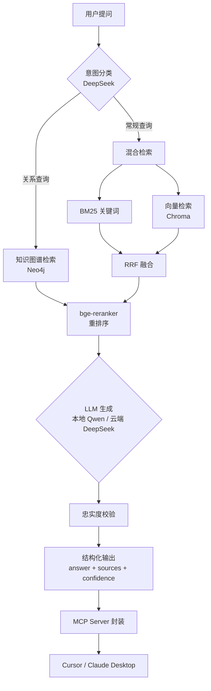

[](https://m8ven.ai/mcp/zhtsy-rag-agent-mbudvh?s=readme)
# 🤖 本地 RAG Agent - 多工具智能问答系统

基于 LangGraph + 本地 Ollama + 知识图谱构建的生产级 RAG Agent，支持混合检索、重排序、多跳推理、结构化输出和 MCP 工具封装。

## ✨ 功能特性

- 🔍 **混合检索**：BM25 关键词检索 + Chroma 向量检索 + RRF 融合
- 🎯 **重排序**：bge-reranker-base 精排检索结果，提升准确率
- 🕸️ **知识图谱**：Neo4j 存储实体关系，支持多跳推理（如"小陈住在哪个省"）
- 📊 **结构化输出**：Pydantic 强制模型输出 JSON（答案 + 来源 + 置信度）
- 💾 **多轮记忆**：MemorySaver 管理对话历史
- 🛡️ **忠实度校验**：检测模型幻觉，防止跨实体污染
- 🌐 **混合推理**：本地 Qwen 处理常规问题，云端 DeepSeek 处理复杂推理
- 🔌 **MCP 封装**：将检索能力封装成标准 MCP Server，任何 MCP 客户端可调用
- 🐳 **Docker 部署**：支持容器化一键部署

## 📊 评估结果

在 30 个测试用例上，平均得分 **0.99**：

| 类别 | 得分 | 用例数 |
| :--- | :--- | :--- |
| 直接检索 | 1.00 | 17 |
| 多跳推理 | 1.00 | 6 |
| 拒答 | 0.92 | 4 |
| 跨主题 | 1.00 | 3 |
| **平均** | **0.99** | **30** |

## 🏗️ 架构图



## 🛠️ 技术栈

| 组件 | 技术 |
| :--- | :--- |
| **Agent 框架** | LangGraph, LangChain |
| **本地 LLM** | Ollama (Qwen2.5:7B) |
| **云端 LLM** | DeepSeek API |
| **向量检索** | Chroma + nomic-embed-text |
| **关键词检索** | BM25 (rank_bm25 + jieba) |
| **重排序** | bge-reranker-base (FlagEmbedding) |
| **知识图谱** | Neo4j + GraphCypherQAChain |
| **Web 服务** | FastAPI, Streamlit |
| **MCP 封装** | FastMCP |
| **部署** | Docker, Docker Compose |

## 📁 项目结构

```text
py_code/
├── rag_agent.py              # Agent 核心逻辑（LangGraph 工作流）
├── graph_retriever.py        # 知识图谱检索工具
├── bm25_retriever.py         # BM25 检索器
├── build_knowledge_base.py   # 向量库构建脚本
├── build_graph.py            # 知识图谱构建脚本
├── eval_system.py            # 四维评估脚本
├── test_cases.json           # 测试用例
├── mcp_server.py             # MCP Server 封装
├── streamlit_app.py          # Streamlit 前端
├── requirements.txt          # Python 依赖
├── Dockerfile                # Docker 镜像
├── docker-compose.yml        # Docker Compose 配置
└── knowledge_base/           # 原始文档目录
```

## 🚀 快速开始

### 前置条件

- Python 3.12+
- Ollama（已安装 `qwen2.5:7b` 和 `nomic-embed-text`）
- Neo4j（Docker 部署）
- DeepSeek API Key（可选，用于复杂推理）

### 1. 安装依赖

```bash
pip install -r requirements.txt
```

### 2. 配置环境变量

创建 `.env` 文件：

```bash
DEEPSEEK_API_KEY=你的API Key
OLLAMA_HOST=http://127.0.0.1:11434
```

### 3. 构建向量库

将文档放入 `knowledge_base/` 目录，然后运行：

```bash
python build_knowledge_base.py
```

### 4. 构建知识图谱（可选）

```bash
# 启动 Neo4j
docker run -d --name neo4j-graphrag \
  -p 7474:7474 -p 7687:7687 \
  -e NEO4J_AUTH=neo4j/password123 \
  -e NEO4J_PLUGINS='["apoc"]' \
  -v neo4j_data:/data \
  neo4j:5

# 构建图谱
python build_graph.py
```

### 5. 运行 Agent

```bash
python rag_agent.py
```

或启动 Streamlit 前端：

```bash
streamlit run streamlit_app.py
```

### 6. 启动 MCP Server（可选）

```bash
python mcp_server.py
```

在 Cursor / Claude Desktop 中配置 MCP Server：

```json
{
  "mcpServers": {
    "my-rag-tools": {
      "command": "wsl",
      "args": [
        "-d", "Ubuntu",
        "-e", "bash", "-lc",
        "cd /home/zh/py_code && /home/zh/myenv/bin/python /home/zh/py_code/mcp_server.py"
      ]
    }
  }
}
```

## 📈 评估

运行评估脚本：

```bash
python eval_system.py
```

评估维度：
- **语义相似度**：生成答案与期望答案的语义匹配度
- **来源准确率**：引用来源是否准确
- **禁止词检查**：是否出现污染或幻觉
- **置信度校准**：模型信心度是否与实际正确率匹配

## 📝 License

MIT
